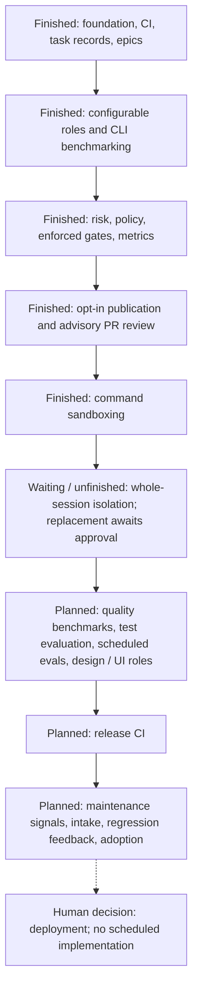

# agent-workbench

Claude Code plugins for everyday development and reviewed task workflows.

## Plugins

- **dev-baseline** bootstraps repositories, sets up Python tooling and automatic
  formatting, guides systematic debugging, and provides an independent code reviewer.
- **task-flow** runs planned changes in Git worktrees. Its AI-native workflow uses
  fresh-context roles and file-based handoffs, plan approval, deterministic baseline
  and round checks, independent criterion review, and policy-controlled autonomy.

See [the usage guide](docs/how-to.md) for setup, the task loop and roadmap evidence.

## Install

Requires Claude Code, Git, and [uv](https://docs.astral.sh/uv/).

```text
/plugin marketplace add jakos/agent-workbench
/plugin install dev-baseline@agent-workbench
/plugin install task-flow@agent-workbench
```

## Roadmap

This is a manually maintained capability snapshot. Arrows show roadmap sequence;
the guide records task evidence and explains declared epic dependencies.



Legend: **Finished** = implemented; **In progress** = active work (none shown);
**Waiting / unfinished** = pending approval or completion; **Planned** = future work;
**Human decision** = no implementation scheduled. Status labels do not depend on colour.
The superseded isolation attempt is unfinished, not actively advancing.

## License

[MIT](LICENSE)
